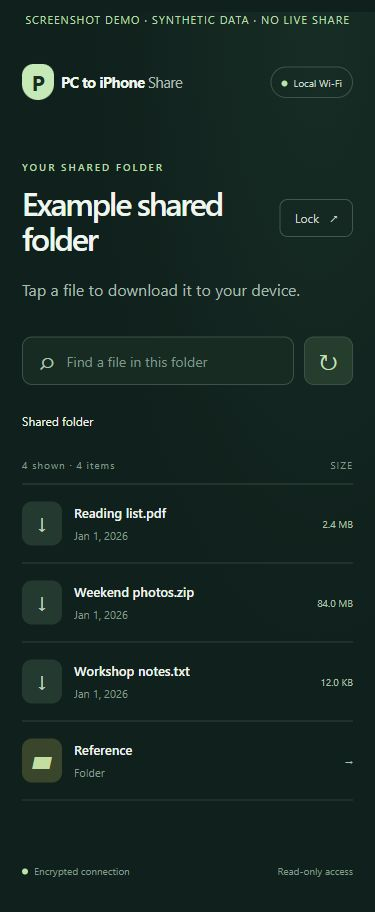
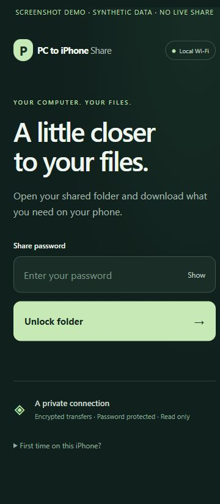

# PC to iPhone Share - transfer files over Wi-Fi

**Download one folder from your Windows, Mac, or Linux computer on your iPhone or Android browser. No cloud upload, cable, account, or phone app.**

Choose a folder, select your private network, pair your phone with the computer's local certificate, and sign in with a generated password. PC to iPhone Share streams read-only downloads directly over HTTPS.

[Download v0.1.0-alpha.1](https://github.com/dibyapp/pc-to-iphone-share/releases/tag/v0.1.0-alpha.1) · [Installation](docs/INSTALL.md) · [Certificate pairing](docs/CERTIFICATES.md) · [Troubleshooting](docs/TROUBLESHOOTING.md)

> **Unsigned alpha.** Portable builds target Windows, macOS, and Linux x64/ARM64. Windows x64 and Ubuntu 24.04 x64 under WSL 2 have passed local runtime tests. Native CI covers every packaged architecture; physical phone/LAN checks and signing remain separate. First-time certificate pairing is manual. See the [validation matrix](docs/PLATFORMS.md) and [security boundaries](SECURITY.md).

 

*Real interface, synthetic screenshot fixture data. These are browser captures, not physical iPhone OS screenshots. No personal filenames, addresses, passwords, or certificates are shown.*

## Download for your computer

| Platform | Intel/AMD x64 | ARM64 |
| --- | --- | --- |
| Windows | [ZIP](https://github.com/dibyapp/pc-to-iphone-share/releases/download/v0.1.0-alpha.1/pc-to-iphone-share-0.1.0-alpha.1-windows-amd64.zip) | [ZIP](https://github.com/dibyapp/pc-to-iphone-share/releases/download/v0.1.0-alpha.1/pc-to-iphone-share-0.1.0-alpha.1-windows-arm64.zip) |
| macOS | [Intel ZIP](https://github.com/dibyapp/pc-to-iphone-share/releases/download/v0.1.0-alpha.1/pc-to-iphone-share-0.1.0-alpha.1-macos-amd64.zip) | [Apple Silicon ZIP](https://github.com/dibyapp/pc-to-iphone-share/releases/download/v0.1.0-alpha.1/pc-to-iphone-share-0.1.0-alpha.1-macos-arm64.zip) |
| Ubuntu / Linux | [TAR.GZ](https://github.com/dibyapp/pc-to-iphone-share/releases/download/v0.1.0-alpha.1/pc-to-iphone-share-0.1.0-alpha.1-linux-amd64.tar.gz) | [TAR.GZ](https://github.com/dibyapp/pc-to-iphone-share/releases/download/v0.1.0-alpha.1/pc-to-iphone-share-0.1.0-alpha.1-linux-arm64.tar.gz) |

[SHA-256 checksums](https://github.com/dibyapp/pc-to-iphone-share/releases/download/v0.1.0-alpha.1/SHA256SUMS) · [Allowlisted source ZIP](https://github.com/dibyapp/pc-to-iphone-share/releases/download/v0.1.0-alpha.1/pc-to-iphone-share-0.1.0-alpha.1-source.zip)

Extract before running. Windows includes `Start-PC-to-iPhone-Share.cmd`; macOS includes a `.command` launcher; Linux includes a shell launcher. Executables include the web assets and require no Node, Python, or Go runtime. Ubuntu, Debian, Linux Mint, Fedora, Arch, openSUSE, and Alpine use the matching Linux build; distro-specific validation is [documented](docs/LINUX.md). Binaries are unsigned and unnotarized; no Homebrew, winget, apt, or App Store package is published.

## Your first download

1. **Start on the computer.** Run the executable/launcher, choose one folder, and select the actual private Wi-Fi/LAN interface reachable by your phone.
2. **Open the local dashboard.** The console prints a private management URL with the new password and setup details. Keep that URL on the computer.
3. **Pair your phone once.** Join the same reachable network. Verify and install only your own computer's public certificate using the [pairing instructions](docs/CERTIFICATES.md). iPhone/iPad users explicitly enable certificate trust in Settings.
4. **Sign in and download.** Open the separate phone URL in Safari or your Android browser, enter the password, and tap a filename.
5. **Finish and stop.** Keep the computer awake and the app running during transfers. Ctrl+C or **Stop sharing** ends sharing.

The app never changes firewall/router rules, installs trust, or starts a background service. The default HTTPS port is 9443. Private state stays outside the share and repository. [Complete installation guide](docs/INSTALL.md) · [Everyday workflows](docs/WORKFLOWS.md)

If Python 3 is already installed, the optional source-repository installer detects your computer's CPU/OS and verifies release checksums:

```sh
python scripts/install.py --dry-run
python scripts/install.py
```

It installs into a new versioned user directory and **does not launch the app or overwrite an existing installation**. On some systems use `python3` or `py`. Manual archive extraction is sufficient without Python.

## Why this workflow?

| Need | PC to iPhone Share's scope |
| --- | --- |
| Download PC files on an iPhone without a phone app | Use Safari to browse the selected computer folder |
| Transfer files from Ubuntu to iPhone without USB | Run the Linux binary and use the same phone browser workflow |
| Avoid a cloud-upload step | Download directly over the selected local network |
| Make only one folder temporarily available | Confined browsing, read-only access, and a stop control |
| Transfer a large file | Streaming and HTTP byte ranges; storage/network/client limits still apply |
| Inspect a small open-source host | Go standard library, embedded assets, MIT license, no third-party Go modules |

For general device-to-device transfers, uploads, remote transfers, or a richer server, compare [LocalSend, PairDrop, croc, and copyparty](docs/ALTERNATIVES.md). PC to iPhone Share is a focused alternative workflow; it is not a complete AirDrop, synchronization, or cloud-storage replacement.

## Privacy and security

- Bind one selected private IPv4 interface and accept peers within its subnet. No cloud relay, UPnP, public-port forwarding, telemetry, request logging, or automatic update checks.
- TLS 1.2+ with a per-installation constrained local CA. The private key stays on the computer; certificate pairing and fingerprint verification are manual.
- Random share password; only a salted PBKDF2-HMAC-SHA256 hash with 600,000 iterations is saved.
- Secure, HttpOnly, SameSite=Strict sessions, with idle/absolute expiry and revocation on logout/restart. Login throttling and bounded resources.
- Exact Host/Origin and fetch-metadata protection for private APIs. Public login-page navigation from another app is allowed.
- Go `os.Root` containment plus rejection of traversal, symlinks/junctions, alternate data streams, and invalid names. Regular files are sent as attachments. No upload, delete, rename, or edit endpoints.
- Loopback-only dashboard protected by a token held in its browser tab. Private state permissions are restricted on Windows/macOS/Linux.

A trusted computer and receiving device are required. Subnet checks do not prove physical Wi-Fi membership. Administrators, hard links, mounts, first-time trust, and denial of service have [specific boundaries](SECURITY.md). There is no independent security audit or stable support guarantee. Report vulnerabilities through [private GitHub reporting](https://github.com/dibyapp/pc-to-iphone-share/security/advisories/new); use synthetic reproduction data.

## Build and contribute

Install [Go 1.26](https://go.dev/dl/) and validate the source:

```sh
git clone https://github.com/dibyapp/pc-to-iphone-share.git
cd pc-to-iphone-share
go test ./...
go vet ./...
go build -trimpath -buildvcs=false -o pc-to-iphone-share .
./pc-to-iphone-share --help
```

Windows: use `-o pc-to-iphone-share.exe` and run `.\pc-to-iphone-share.exe`. See [CONTRIBUTING.md](CONTRIBUTING.md) for focused PRs, privacy checks, and native testing. [CI](https://github.com/dibyapp/pc-to-iphone-share/actions/workflows/ci.yml) covers all packaged architectures. Release generation is manual; the website has no deployment workflow.

## Common questions

**Does the running app need internet?** No. It needs a reachable local network. Downloading the app/toolchain initially may require internet.

**Can my phone upload files back?** This version is download-only from computer to receiving device.

**Where are iPhone downloads?** Check Safari Downloads or Files. Downloading media does not automatically import it into Photos or Music.

**Why a certificate?** A private LAN address lacks a publicly trusted identity. Pairing with the local CA lets your browser verify its HTTPS connection. Trust on the computer does not automatically transfer to the phone.

**Does it work remotely?** Internet sharing, IPv6-only networks, mobile server hosting, and 32-bit desktop builds are outside this alpha's scope.

If PC to iPhone Share solves your folder-download problem, a star helps others find it. Bug reports and verified platform results are equally useful.

Maintainer and author: [dibyapp](https://github.com/dibyapp). Application: [MIT](LICENSE). Go runtime: [BSD notice](THIRD_PARTY_NOTICES.md).
