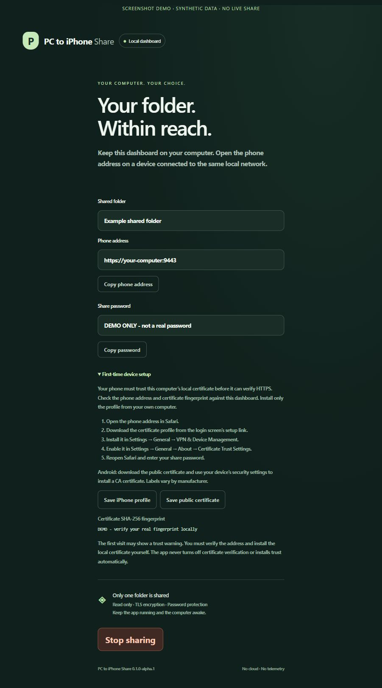

# Install PC to iPhone Share on Windows, macOS, or Linux

Current release: **v0.1.0-alpha.1**, an unsigned alpha. Binaries are portable console applications, not native GUI installers. You need the app only on the computer; the phone uses its browser. First-time local-certificate pairing is manual.

## 1. Choose your computer's build

| Computer | Download | Start after extraction |
| --- | --- | --- |
| Windows, most Intel/AMD PCs | [Windows x64 ZIP](https://github.com/dibyapp/pc-to-iphone-share/releases/download/v0.1.0-alpha.1/pc-to-iphone-share-0.1.0-alpha.1-windows-amd64.zip) | Double-click `Start-PC-to-iPhone-Share.cmd` |
| Windows ARM PC | [Windows ARM64 ZIP](https://github.com/dibyapp/pc-to-iphone-share/releases/download/v0.1.0-alpha.1/pc-to-iphone-share-0.1.0-alpha.1-windows-arm64.zip) | Double-click `Start-PC-to-iPhone-Share.cmd` |
| Mac with Apple Silicon | [macOS ARM64 ZIP](https://github.com/dibyapp/pc-to-iphone-share/releases/download/v0.1.0-alpha.1/pc-to-iphone-share-0.1.0-alpha.1-macos-arm64.zip) | Run `./pc-to-iphone-share` in Terminal |
| Mac with Intel processor | [macOS Intel ZIP](https://github.com/dibyapp/pc-to-iphone-share/releases/download/v0.1.0-alpha.1/pc-to-iphone-share-0.1.0-alpha.1-macos-amd64.zip) | Run `./pc-to-iphone-share` in Terminal |
| Ubuntu/Linux, Intel/AMD x64 | [Linux x64 TAR.GZ](https://github.com/dibyapp/pc-to-iphone-share/releases/download/v0.1.0-alpha.1/pc-to-iphone-share-0.1.0-alpha.1-linux-amd64.tar.gz) | Run `./pc-to-iphone-share` in a terminal |
| Ubuntu/Linux, ARM64 | [Linux ARM64 TAR.GZ](https://github.com/dibyapp/pc-to-iphone-share/releases/download/v0.1.0-alpha.1/pc-to-iphone-share-0.1.0-alpha.1-linux-arm64.tar.gz) | Run `./pc-to-iphone-share` in a terminal |

Download on your **computer**, extract into its own app folder, and keep it outside the folder you will share. The binary includes all app assets; Python/Node/Go are not required to run it. Linux distributions use the same Linux archive for the CPU; [Linux/Ubuntu details](LINUX.md). Native test results and runtime baselines are in [PLATFORMS.md](PLATFORMS.md).

These binaries are not signed or notarized. macOS/Windows may block unsigned downloads. The app does not bypass operating-system protections; building from inspected source is an alternative until signing is available. No Homebrew, winget, apt, or App Store package is published.

## 2. Verify the download

Get [SHA256SUMS](https://github.com/dibyapp/pc-to-iphone-share/releases/download/v0.1.0-alpha.1/SHA256SUMS) from the same release and compare your archive's digest with the exact filename in it.

Windows PowerShell, in the download directory:

```powershell
Get-FileHash .\pc-to-iphone-share-0.1.0-alpha.1-windows-amd64.zip -Algorithm SHA256
```

macOS:

```sh
shasum -a 256 pc-to-iphone-share-0.1.0-alpha.1-macos-arm64.zip
```

Linux:

```sh
sha256sum pc-to-iphone-share-0.1.0-alpha.1-linux-amd64.tar.gz
tar -xzf pc-to-iphone-share-0.1.0-alpha.1-linux-amd64.tar.gz
./pc-to-iphone-share --version
```

Checksums detect changed/corrupt downloads; a manifest from the same repository is not an independent signature. Use the official `dibyapp/pc-to-iphone-share` repository and inspect source if you need stronger provenance.

## 3. Choose, pair, download

Start the launcher/executable, select a folder, and choose your actual private Wi-Fi/LAN interface. Open the **local dashboard** printed in the console. Keep that management URL private. Join the same reachable network on your phone and use the separately displayed **phone URL**.

Follow [CERTIFICATES.md](CERTIFICATES.md) to verify and install only your own computer's public certificate. Sign in with the generated password and tap a file. Keep the computer awake and the app running until the transfer finishes. Ctrl+C or **Stop sharing** ends the session.



## Optional: checksum-verifying portable installer

If Python 3 is already available, download/inspect the repository source, then run:

```sh
python scripts/install.py --dry-run
python scripts/install.py
```

On Linux/macOS the command may be `python3`; on Windows it may be `py`. The script chooses the matching CPU/OS, downloads this pinned release over HTTPS, verifies SHA-256, rejects unsafe archive paths/links, and installs into a **new versioned user directory**. It does not run the app, require admin privileges, modify PATH, install trust, change firewall/router settings, or overwrite an existing installation. Choose another new directory with `--directory` if the version is already installed. No shell pipe-to-execution shortcut is offered.

Default installation bases: Windows local app data → `Programs/PCToIPhoneShare`; macOS → `Applications/PCToIPhoneShare` inside the user's home; Linux → `.local/lib/pc-to-iphone-share` inside the user's home. Runtime private state is separate from these portable files.

## Build directly from source

Install [Go 1.26](https://go.dev/dl/), clone the repository, and validate before running:

```sh
git clone https://github.com/dibyapp/pc-to-iphone-share.git
cd pc-to-iphone-share
go test ./...
go vet ./...
go build -trimpath -buildvcs=false -o pc-to-iphone-share .
./pc-to-iphone-share --help
```

On Windows build with `-o pc-to-iphone-share.exe`, then run `.\pc-to-iphone-share.exe`. Contributors can run the isolated synthetic smoke checks in [WORKFLOWS.md](WORKFLOWS.md). Experienced Go users can use `go install github.com/dibyapp/pc-to-iphone-share@v0.1.0-alpha.1`; the command downloads/builds code and places the binary in Go's configured binary directory.

## Update and uninstall

Download a later release into a new versioned directory. Finish current transfers and stop the old app before manually launching the new binary. No auto-updater or background service is installed. Uninstall by deleting portable files after stopping the app; remove private state and paired-device trust only if you intend to discard that installation. No script automatically removes passwords, certificates, or another running process.
